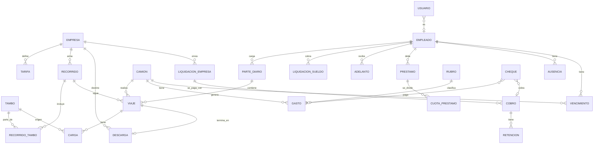

# 08 · Modelo de datos (borrador v2)

## Entidades y campos clave
| Entidad | Campos principales |
|---|---|
| Empresa | nombre, esquema de tarifa, margen de error permitido |
| Tarifa | empresa, tipo (por recorrido / km+litros), valores, vigente desde/hasta |
| Tambo | nombre, ubicación, contacto |
| Recorrido | empresa, nombre, tambos en orden, vigencia/temporada |
| Camión | patente, modelo, año, estado, cuotas |
| Empleado | nombre, DNI, categoría (corta/larga), fecha ingreso, antigüedad, documentos, activo |
| Parte diario | fecha, empleado, camión, horas inicio/fin, observaciones, estado (borrador/enviado/aprobado) |
| Viaje | parte, recorrido, km, hora salida/llegada |
| Carga | viaje, tambo, litros, **temperatura**, **acidez (ok/rechazada)**, método (caudalímetro/regla), foto ticket, foto remito, aviso rechazo |
| Descarga | viaje, empresa destino, litros descargados, diferencia, supera margen |
| Liquidación de empresa | empresa, mes, litros, km, monto, archivo adjunto, diferencias detectadas |
| Cobro | liquidación, fecha, medio (transferencia/e-cheq), monto, orden de pago |
| Retención | cobro, tipo (ganancias/IIBB/seg. social), monto |
| Liquidación de sueldo | empleado, mes, esquema, conceptos (básico, antigüedad, horas/km, viáticos, comida, domingos, franco no gozado, bono), descuentos, neto a pagar |
| Adelanto | empleado, fecha, monto, % del sueldo, mes de descuento o cuotas |
| Préstamo / cuota | empleado, monto, cuotas, cuota pagada por la empresa, cuota descontada |
| Ausencia | empleado, tipo (franco/vacaciones/enfermedad/otro), desde, hasta, aprobada |
| Rubro | nombre (lista de mamá), ámbito |
| Gasto | fecha, rubro, monto, camión (opcional), ámbito (empresa/personal), tipo de comprobante, medio de pago, proveedor, foto |
| Cheque | tipo (emitido/recibido), físico o e-cheq, número, banco, monto, emisión, fecha de pago, contraparte, estado |
| Vencimiento | objeto (camión/empleado), tipo (VTV, seguro, licencia, psicofísico, service), fecha, aviso |
| Usuario | nombre, rol (papá/mamá/chofer), PIN, empleado asociado |

## Notas de diseño
- Tarifas, margen de error, tope de adelantos y valores del convenio son **parámetros con vigencia**, no constantes.
- Un **parte diario** puede tener hasta 2 viajes; cada viaje de 1 a 6 cargas.
- Los gastos admiten **camión opcional**: lo importante es empezar a capturarlo.
- Los datos externos (Holistor, ARCA) no se modelan; solo se exporta/importa por archivo.

## Cambios ronda 3 (2026-10-14)
| Entidad | Cambio |
|---|---|
| Empresa | Molfino (marca La Paulina) y Manfrey; margen permitido **0,2 %**; formato de hoja de ruta a definir con la muestra |
| Hoja de ruta global | No es una tabla: es una **salida** (texto/Excel/PDF) generada de los partes del día |
| Remito | Nueva: viaje/carga, nº de remito, nº de tambo, fecha, hora, foto |
| Carga | Se agrega **aviso a fábrica** (a quién, cuándo, medio) cuando la acidez es positiva |
| Escala salarial | Nueva: mes, categoría (corta/larga), básico, antigüedad, viáticos, comida, valor por km o recorrido, bono |
| Valor del día | **Corregido:** forma parte de la **escala salarial** del mes (lo fija el sindicato) |
| Descuento por margen | **Corregido:** se calcula **por mes y empresa**: litros cargados, litros descargados, % de diferencia, valor leche, importe |
| Préstamo | Se agrega mutual, garantía, cuota mensual, cuotas restantes y saldo |
| Cheque | Se agrega banco (opcional), estado (pendiente, cobrado, rechazado) y concepto |
| Camión | Rotación: el parte guarda el camión del día; gastos de combustible/repuestos exigen camión |

## Cambios ronda 3 (2026-10-30)
| Entidad | Cambio |
|---|---|
| Camión | Se agrega **rol en la flota**: regular, relevo, días de barro |
| Remito | Número **único por empresa**; lo emite la empresa |
| Carga | `aviso_a` pasa a ser el **área de producción primaria** de la empresa |
| Cheque | Se agrega **origen**; si fue rechazado, referencia al **cheque de reemplazo** |
| Escala salarial | Incluye: sueldo mensual por categoría, valor km por ítem, comida y viático especial por unidad, valor de domingo y franco, porcentajes de descuentos, cuota de afiliación, divisor de horas (192) |
| Liquidación de sueldo | Dos niveles: **recibo teórico** (según la escala) y **pago real** (recibo + ajustes). Los ajustes no emiten recibo |
| Retención | Pasa a ser opcional; ARCA es la fuente del resumen |
| Vencimiento | Semáforo derivado de la fecha (≤ 7 días amarillo, vencido rojo) y lista de alertas configurable |
| Proveedor | Estaciones, talleres y otros: se dan de alta al usarlos |

## Cambios ronda 4 (2026-11-04) · Migración de Servicios Operativos y Seguridad
| Entidad / Tabla | Naturaleza | Descripción |
|---|---|---|
| `tambos_salteados` | Tabla nueva | Registro de contingencias en ruta (tranquera cerrada, falta de luz, camino intransitable) con foto y observaciones (RF45). |
| `averias` | Tabla nueva | Incidentes mecánicos reportados en ruta con categoría, severidad (`baja`/`media`/`alta`) y fotos de comprobante (RF48). |
| `cubiertas` | Tabla nueva | Trazabilidad física individual de neumáticos por posición en chasis (22 ruedas de rodado + 2 auxilios), marca, serie, código `DOT` (semana/año), profundidad de dibujo en milímetros (`mm`), km actuales, recapados y rotaciones (RF29). |
| `cargas_combustible` | Tabla nueva | Bitácora de cargas de gasoil en ruta por camión: odómetro (km), litros, estación, tanque lleno, foto de ticket y cálculo de rendimiento en `L/100 km` (RF06). |
| `gastos_fijos` | Tabla nueva | Plantillas de gastos recurrentes (seguros, abonos, planes ARCA, contador) para autogeneración mensual (RF26). |
| `solicitudes_correccion` | Tabla nueva | Petición del chofer a papá para habilitar edición en partes ya enviados por error en carga/litros (RF46). |
| `perfiles` | Columnas nuevas | `pin_hash` (pgcrypto/sha256), `intentos_fallidos`, `bloqueado_hasta`, `sesion_revocada_en` para autenticación segura y revocación remota (RF39, RF40). |

## Implementación
- **Esquema canónico:** `database/schema.sql` (incluye las tablas de Etapa 1 + tablas operativas de Etapa 2 con RLS y RPCs `app.verificar_pin` y `app.revocar_sesiones_empleado`).
- **Migraciones versionadas:**
  - `database/migrations/001_initial_schema.sql`
  - `database/migrations/002_servicios_operativos.sql` (rollback: `database/migrations/002_rollback.sql`)
- **Pruebas de RLS:** `database/test/rls_test.sql` (verificado con suite de aislamiento multi-rol).
