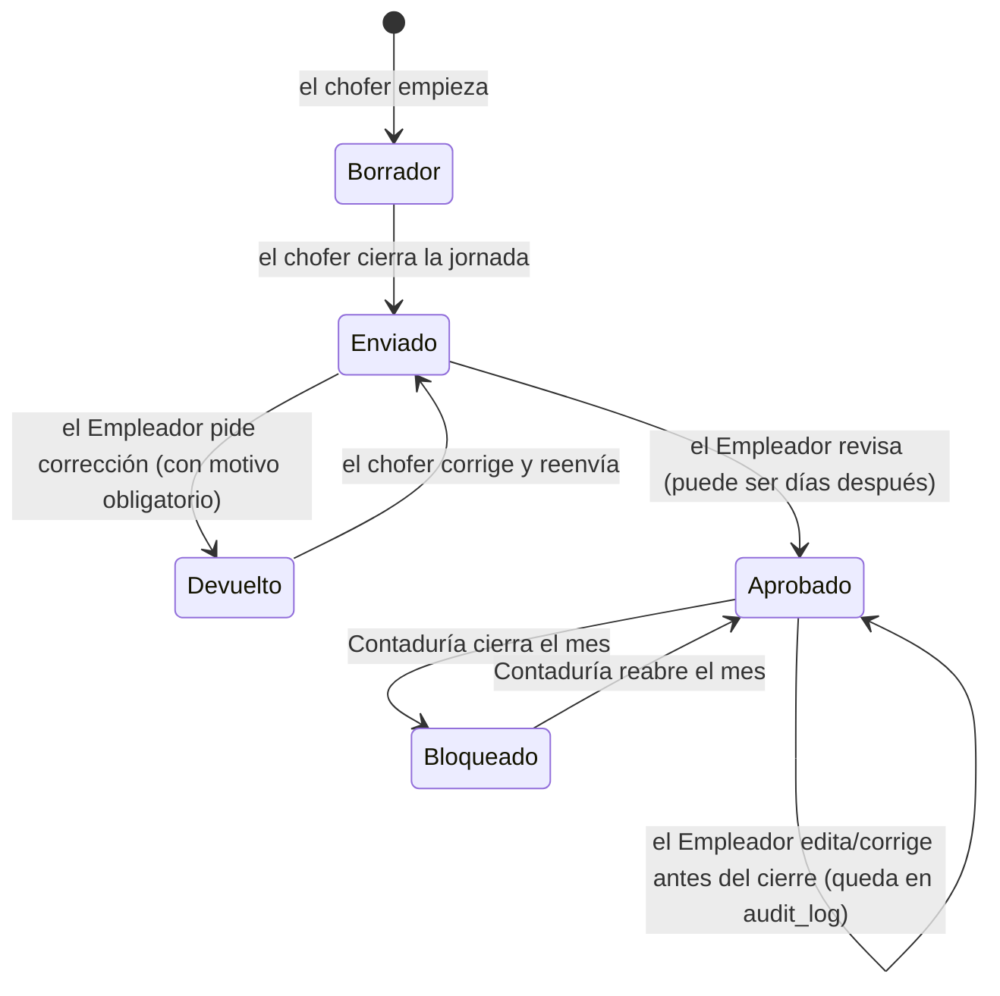
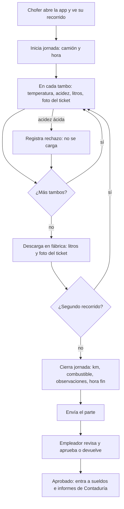

# 13 · Vista del Empleado (chofer): análisis y especificación

Fecha: 2026-10-02 · Actualizado: 2026-10-31 (incorpora definiciones de ronda 3 y esquema SQL).

## 1. Las tres vistas
| Vista | Quién | Dispositivo | Rol principal |
|---|---|---|---|
| **Empleado** | Choferes (y papá cuando maneja) | Celular | **Cargar** el parte diario; consultar lo propio |
| **Empleador** | Papá | iPhone | **Revisar y aprobar** lo cargado; gestionar personal, tarifas, vencimientos |
| **Contaduría** | Mamá | Computadora (Chrome) | Cheques, gastos, sueldos, reportes, exportaciones |

Las tres leen y escriben la misma base: lo que carga el empleado aparece al instante en Empleador y, una vez aprobado, en Contaduría.

## 2. Principios de diseño
1. **Tarda menos de 2 minutos por recorrido.** Si tarda más que anotar a mano, no se usa.
2. **Nunca se usa manejando.** Se carga con el camión detenido: en cada tambo o al terminar.
3. **Pocos campos, botones grandes**, números con teclado numérico, listas en vez de texto libre.
4. **Autoguardado de borrador**: si se corta la señal o se cierra la app, no se pierde lo cargado.
5. **El empleado ve solo lo suyo.**
6. **Funciona en cualquier celular** (iPhone o Android) desde el navegador, sin tiendas de apps.

## 3. Qué hace falta para que funcione (checklist)
**Datos maestros (los carga el Empleador antes de arrancar)**
- [ ] Empresas y sus tarifas
- [ ] Tambos y recorridos (con orden de tambos y empresa)
- [ ] Camiones
- [ ] Empleados con categoría (corta/larga distancia)

**Acceso**
- [ ] Alta de usuario por cada empleado (el Empleador lo crea)
- [ ] Ingreso simple: usuario + **PIN** (4-6 dígitos); opcional huella/Face ID del celular
- [ ] Sesión larga (no pedir clave todos los días) y bloqueo tras varios intentos fallidos
- [ ] Reinicio de PIN por el Empleador y **revocar sesión** si se pierde el celular

**Operación**
- [ ] Definir cómo se asigna el recorrido del día (ver sección 6)
- [ ] Cámara para foto del ticket (con compresión para no gastar datos)
- [ ] Guía impresa de 1 página y capacitación de 15 minutos
- [ ] Un mes **en paralelo con el cuaderno** antes de abandonarlo
- [ ] Alguien de la familia que dé soporte a los choferes

## 4. Ciclo de vida del parte diario

- **Borrador:** editable por el chofer. **Enviado:** el chofer terminó; **ya cuenta** y Contaduría lo ve marcado "sin revisar". **Devuelto:** requiere motivo del Empleador y vuelve a ser editable por el chofer. **Aprobado:** revisado por el Empleador (si el Empleador corrige un dato antes del cierre de mes, el cambio queda registrado en `audit_log`). **Bloqueado:** mes cerrado; solo se modifica reabriendo el mes (queda registrado).
- **Ajuste 2026-10-30:** los remitos se hacen día a día y no se pueden verificar antes de entregarlos, así que la revisión de papá **no frena** al chofer. Lo que sí se exige es que **no quede ningún parte sin revisar al cerrar el mes** (RF71).

## 5. Flujo del día

## 6. Asignación del recorrido (decidido: opción C)
| Opción | Cómo funciona | Pros | Contras |
|---|---|---|---|
| A | El Empleador asigna recorrido y camión de cada chofer cada día (o semana) | Control total; se parece a lo que hoy hace por WhatsApp | Un paso más para papá |
| B | El chofer elige su recorrido de una lista | Cero trabajo para papá | Posibles errores |
| C | **Plan base semanal** (cada chofer, su recorrido y camión habitual) y el chofer solo confirma o cambia | Mínimo esfuerzo; refleja que los recorridos son mayormente fijos | Hay que mantener el plan al cambiar la temporada |

**Decisión (2026-10-30):** papá confirmó que **la asignación suele ser fija**. La flota es de 7 camiones: 5 regulares, **1 de relevo** y **1 para días de barro**. Se usa la opción **C**: cada chofer tiene un plan base (camión y recorrido habituales) que ve al abrir la app, y el chofer o el Empleador pueden cambiar el camión del día (relevo o barro) y queda constancia.

## 7. Pantallas (esquema)
1. **Inicio**: saludo, recorrido de hoy, botón grande "Iniciar jornada" / "Continuar", estado del parte.
2. **Cargar tambo**: tambo (de la lista del recorrido, u "Otro"), litros, método (caudalímetro/regla), temperatura, acidez, foto del ticket.
3. **Descarga**: empresa/fábrica, litros descargados, foto del ticket; el sistema muestra la diferencia con lo cargado.
4. **Cerrar jornada**: hora de fin, km, combustible (opcional), observaciones, domingo/feriado.
5. **Mis partes**: partes del mes con estado (borrador, enviado, devuelto, aprobado).
6. **Mis francos y vacaciones**: calendario y pedido.
7. **Mi cuenta**: adelantos y, según decisión, sueldo (ver sección 10).
8. **Reportar problema** (opcional): avería o incidente con foto y descripción.

## 8. Campos y validaciones
**Carga por tambo**
| Campo | Tipo | Obligatorio | Validación |
|---|---|---|---|
| Tambo | lista del recorrido / "Otro" | Sí | "Otro" exige observación |
| Hora | automática | Sí | Editable con motivo |
| Litros | número | Sí | > 0, salvo rechazo; alerta si se aleja del habitual de ese tambo |
| Método | caudalímetro / regla | Sí | Si es regla, observación opcional |
| Temperatura | °C | Sí | Rango a definir; alerta fuera de rango |
| Acidez | OK / ácida | Sí | Si es ácida: litros = 0 y se registra rechazo |
| Foto del ticket | imagen | Sí con caudalímetro | Compresión automática |
| Observación | texto corto | No | |

**Descarga**
| Campo | Tipo | Obligatorio | Validación |
|---|---|---|---|
| Empresa/fábrica | lista | Sí | |
| Litros descargados | número | Sí | Alerta si la diferencia con lo cargado supera el **margen configurable** |
| Foto del ticket | imagen | Sí | |

**Cierre de jornada**
| Campo | Tipo | Obligatorio | Validación |
|---|---|---|---|
| Hora inicio / fin | hora | Sí | Fin > inicio; corta distancia: base de las horas extras |
| Km | número (odómetro o km del recorrido) | Sí en larga distancia | Fin ≥ inicio |
| Combustible | litros, odómetro (km), estación, foto ticket | No | Camión asignado automáticamente; calcula rendimiento en `L/100 km` (sin generar gasto en efectivo en Contaduría) |
| Domingo/feriado | casilla | Auto | Según fecha, editable |
| Observaciones | texto | No | |

## 9. Casos borde
| Caso | Comportamiento propuesto |
|---|---|
| Cambio de camión durante el día | Se permite cambiar y queda registrado desde qué hora |
| Reemplazo (relevo) | El Empleador asigna el parte al relevo o el relevo ingresa con su usuario |
| Recorrido no planificado / tambo extra o salteado | Se permite agregar o marcar "no visitado" con motivo |
| Dos recorridos en el día | Un parte con dos viajes, cada uno con su descarga |
| Se olvidó de cargar | Carga tardía con la fecha real; queda marcada como "cargada después" |
| Error de tipeo | El chofer corrige hasta que el parte se aprueba; luego solo con pedido al Empleador |
| Caudalímetro roto | Método "regla"; se exige observación |
| Sin señal momentánea | Borrador local y reenvío automático al volver |
| Leche ácida | Rechazo registrado, sin litros; avisa al Empleador |
| Celular perdido | El Empleador revoca la sesión desde su vista |
| Papá maneja | Usa su usuario de Empleado y aprueba con el de Empleador (o se define que no requiere aprobación) |
| Dos choferes con el mismo celular | No recomendado; sesión por usuario |

## 10. Qué ve el empleado de su dinero (decisión)
| Nivel | Contenido | Comentario |
|---|---|---|
| A | Solo sus partes y horas/km | Lo que mamá pidió ("solo sus viajes") |
| B | A + sus adelantos y francos | **Recomendado para el MVP** |
| C | B + sueldo estimado del mes | Riesgo: un cálculo desfasado genera reclamos; habilitar solo cuando el cálculo coincida con la planilla real |
| D | C + liquidación final al cerrar el mes | Útil para transparencia; requiere acuerdo de papá y mamá |

Papá dijo que a los choferes "les gusta ver todo"; mamá pidió que no vean ingresos/egresos de la empresa. Ambos pedidos son compatibles: el empleado ve **lo suyo**, no lo de la empresa.

## 11. Seguridad, privacidad y aspectos laborales
- El empleado accede solo a sus datos; no ve sueldos ni adelantos de otros ni nada de Contaduría.
- Todo cambio queda registrado (quién, cuándo, qué valor había).
- Los registros de **horas y jornada** pueden tener efecto laboral. Conviene que el empleado pueda ver lo que cargó y pedir correcciones, y consultar con el contador cómo se archivan.
- Los datos personales de empleados (DNI, CUIL, licencias) son sensibles: acceso restringido, sin copias sueltas ni en el repo.

## 12. Plan de adopción
1. **Piloto**: 1-2 choferes durante 2 semanas, **en paralelo** con el cuaderno.
2. **Ajustes** según sus comentarios.
3. **Todos los choferes**, un mes más en paralelo.
4. **Corte**: papá deja el cuaderno cuando se cumplan los criterios.

**Criterios de éxito:** al menos 95% de los partes cargados el mismo día · menos de 2 min por recorrido · diferencia con el cuaderno menor al 2% · mamá recibe la planilla sin correcciones.

## 13. Riesgos
| Riesgo | Mitigación |
|---|---|
| Choferes no cargan o cargan mal | Pocos campos, piloto, recordatorio, papá revisa |
| Carga manejando | Diseño para cargar con el camión detenido; capacitación |
| Datos sensibles expuestos | Login por usuario, PIN, revocar sesión, roles |
| Cálculo de sueldo visible y erróneo | Mostrarlo solo cuando coincida con la planilla real |
| Resistencia al control ("me controlan") | Explicar el objetivo (evitar errores en el sueldo) y transparencia |
| Fotos que consumen datos | Compresión y límite de tamaño |
| Nadie da soporte | Definir quién (ver preguntas para el equipo) |

## 14. Preguntas abiertas
Ver `09-preguntas/seguimiento.md`, secciones "Parte 2" y "Para los choferes".

## 15. Ajustes tras la ronda 3 (2026-10-14)
- **La hoja de ruta global es el centro del parte.** (Corregido 2026-10-30: es **una sola, global, enviada por mensaje** a la planta.) El sistema la **genera** como texto listo para compartir por WhatsApp y como Excel/PDF (RF53). Falta una muestra para copiar el formato.
- **Remito por tambo:** el chofer sigue firmando el remito en papel. En la app se carga el **número de remito**, el nº de tambo y una **foto** (RF54). Fecha y hora se completan solas.
- **Leche ácida:** además del rechazo, se registra **el aviso al área de producción primaria de la empresa, cuándo y por qué medio** (RF55).
- **Margen 0,2 %:** al cargar la descarga, la app muestra la diferencia del viaje como **aviso preventivo**. El control real es **mensual** por empresa (ver RF56).
- **Camión del día:** el chofer ve su camión habitual y puede cambiarlo (relevo o días de barro).
- **Combustible:** si lo carga el chofer, el camión queda asignado automáticamente.
- **Pendiente:** entrevista a los choferes. Se avanza con los supuestos de trabajo de `12-hallazgos-y-analisis.md`, sección 9.

## 16. Ajustes tras la ronda 3 (2026-10-30)
- **Remito:** lo entrega la empresa y viene **numerado**. El chofer carga ese número (único por empresa) y una foto.
- **Revisión posterior:** el chofer no espera aprobación. Papá revisa cuando puede; el mes no se cierra con partes sin revisar.
- **Hoja de ruta global:** se genera con los partes enviados del día. Falta saber si se manda todos los días o por semana.
- **Horas (corta distancia):** la jornada es de 8 horas; lo que supere es extra (50 % / 100 %). El navegador del camión podría servir para validar horarios (a investigar).

## 17. Estado de implementación al 2026-11-06
- **Completado y probado en `app/`**:
  - `EmpleadoDashboard.tsx`: Carga ágil en cabina con teclado táctil y físico, **paleta dual Cabina Nocturna (`#0b1326`) / Cabina Día Sol Directo (`.theme-sol` en `#f1f5f9` con tarjetas blancas `#ffffff` y tinta `#020617` AAA)**, feedback háptico (`haptics.ts`), botones físicos táctiles con bisel y relieve mecánico (`.btn-tactile`), teclas stepper `[-]` / `[+]` de 56px para Litros y Temperatura en cabina, checklist de tambos con tarjetas de telemetría dual (borde de estado 3px), **edición y eliminación en 1 toque de cargas ya registradas mientras el parte está en borrador o devuelto (`actualizarCarga`, `eliminarCarga` — RF05)**, **auto-sugerencia correlativa de N.º de remito (`sugerirSiguienteRemito` — R00a)**, **pre-selección del camión habitual del chofer (`obtenerCamionHabitualChofer`)**, chips de temperatura rápida (`3.5°`, `3.8°`, `4.0°`, `4.2°`, `4.5°`, `5.0°`) con alerta si supera los 5.5 °C, control de acidez y rechazo con aviso a planta, soporte de 2.º viaje diario, descarga en fábrica con selección rápida de planta (`Manfrey`, `Molfino`) + ticket/foto opcional, cierre con `Km Salida` y `Km Llegada` opcionales, retorno directo a `Modo Empleador` para Papá (RF34) y barra secundaria limpia de `Auxilio y Ruta (Gasoil / Avería)`.
  - **Aprendizaje Histórico de Litros y Temperatura por Tambo (Smart Anomaly Warning - `asistenteRecorridoService.ts`)**: calcula la media móvil y rango habitual de cada tambo; si el chofer ingresa un volumen con posible cero de más ($> 2.2\times$) o cero de menos ($< 0.35\times$), o temperatura $> 5.5\text{ }^\circ\text{C}$, muestra una advertencia reactiva inmediata en cabina previniendo errores de tipeo, además de sugerir en 1 toque el próximo tambo pendiente del recorrido.
  - **Bitácora de Combustible y Rendimiento en L/100 km (`CargaCombustibleModal.tsx` + `combustibleService.ts`)**: registra litros cargados en ruta, odómetro del camión (km), estación, tanque lleno y foto del ticket, calculando el rendimiento en `L/100 km` y emitiendo alerta si supera el umbral de $38\text{ L/100 km}$ (sin generar gastos en efectivo en Contaduría, dado que el gasoil se abona con cheque en estación).
  - **Reporte de Averías Mecánicas en Ruta (`ReportarAveriaModal.tsx` + `averiasService.ts`)**: permite al chofer reportar desperfectos del camión categorizados por sistema mecánico y severidad (`baja` / `media` / `alta`), adjuntando foto para la bandeja de mantenimiento del Empleador.
  - **Autodetección de 2.º Viaje Diario y Pre-asignación**: si el chofer completó su 1.º viaje antes de las 13 hs, la app ofrece en cabina "+ Iniciar 2.º Viaje (Tarde)" pre-configurando el mismo camión y el recorrido vespertino.
  - **Auto-generación de Gastos Fijos el Día 1 de cada Mes (`ContaduriaDashboard.tsx` + `gastosFijosService.ts`)**: banner reactivo en Contaduría para asentar en 1 clic los gastos fijos del mes (seguros, planes ARCA, alquiler de cisterna).
  - **Auto-sugerencia de Cheques en Cartera al Pagar Gastos (`GastosView.tsx` + `chequeService.ts`)**: sugiere la combinación óptima de cheques de terceros en cartera (próximos a vencer) para endosar y cancelar compras mayores.
  - **Modo "Una Sola Mano" (Dock táctil inferior)**: concentra en la parte inferior de la pantalla los accesos críticos al alcance del pulgar (`+ Próximo Tambo Sugerido` y `Descarga`).
  - **Confirmación Antivibración Deslizable (`SlideToConfirm.tsx`)**: acompaña el cierre del parte con un slider que exige desplazar el 88 % del riel para evitar cierres accidentales producidos por baches o vibración del camión en caminos de tierra.
  - `MiCuentaChoferView.tsx`: Módulo de Nivel B con resumen operativo en vivo del mes (viajes aprobados, kilómetros recorridos, domingos trabajados y francos gozados), solicitud de adelantos con tope del 30 % del neto teórico, historial de saldos y solicitudes de francos.
  - Conexión a Supabase (Postgres 17 + Storage) con fallback offline transparente y 100 % de tests pasando en Vitest.
